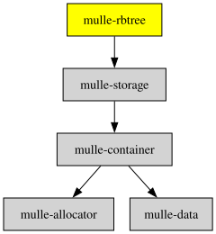

# mulle-rbtree

#### 🍫 mulle-rbtree organizes data in a red/black tree

This is an implementation of a [red-black tree](https://en.wikipedia.org/wiki/Red%E2%80%93black_tree).
[mulle-allocator](//github.com/mulle-c/mulle-allocator) is used to simplify
memory management. It isn't thread-safe.


| Release Version                                       | Release Notes  | AI Documentation
|-------------------------------------------------------|----------------|---------------
|      [](//github.com/mulle-c/mulle-rbtree/actions) | [RELEASENOTES](RELEASENOTES.md) | [DeepWiki for mulle-rbtree](https://deepwiki.com/mulle-c/mulle-rbtree)


## Documentation & Guides

* [API Summary](asset/dox/api/toc)


## Info

Red-black trees are difficult to explain without lots of diagrams, so little
attempt is made to document this code.  However, an excellent discussion can
be found in the following book, which was used as the reference for writing
this implementation:

```
   Introduction to Algorithms
   Thomas H. Cormen, Charles E. Leiserson, and Ronald L. Rivest
   MIT Press (1990)
   ISBN 0-07-013143-0
```

Some functions use a comparison function pointer, which is expected to have the
following prototype:

``` c
   int (*compare)( void *payload_a, void *payload_b);
```

Interpretation of comparison function return values:

| Return value | Comparison
|--------------|-------------------
|  `< 0`       | `a_a < a_b`
|    `0`       | `a_a == a_b`
|  `> 0`       | `a_a > a_b`


### You are here




## Add

### Add mulle-rbtree via mulle-core

mulle-rbtree is a component of the
[mulle-core](//github.com/mulle-core/mulle-core) library.
In your code include its umbrella header:

``` c
#include <mulle-core/mulle-core.h>
```

Add mulle-core to your `CMakeLists.txt` with
[FetchContent](https://cmake.org/cmake/help/latest/module/FetchContent.html):

``` cmake
include( FetchContent)

set( MULLE__CORE_TAG "master" CACHE STRING "branch or tag to fetch mulle-core from")

FetchContent_Declare( MULLE__CORE
   GIT_REPOSITORY https://github.com/mulle-core/mulle-core.git
   GIT_TAG        "${MULLE__CORE_TAG}")
FetchContent_MakeAvailable( MULLE__CORE)

target_link_libraries( ${PROJECT_NAME} PUBLIC mulle-core)
```

Or add to your mulle-sde project with:

``` sh
mulle-sde add mulle-core/mulle-core
```


### Add mulle-rbtree as a cmake subproject

In your code include its header:

``` c
#include <mulle-rbtree/mulle-rbtree.h>
```

Add mulle-rbtree and its dependencies to your `CMakeLists.txt` with
[FetchContent](https://cmake.org/cmake/help/latest/module/FetchContent.html):

``` cmake
include( FetchContent)

include_directories( SYSTEM "${CMAKE_BINARY_DIR}/include")

set( MULLE__STORAGE_TAG "master" CACHE STRING "branch or tag to fetch mulle-storage from")

FetchContent_Declare( MULLE__STORAGE
   GIT_REPOSITORY https://github.com/mulle-c/mulle-storage.git
   GIT_TAG        "${MULLE__STORAGE_TAG}")
FetchContent_MakeAvailable( MULLE__STORAGE)

set( MULLE__RBTREE_TAG "master" CACHE STRING "branch or tag to fetch mulle-rbtree from")

FetchContent_Declare( MULLE__RBTREE
   GIT_REPOSITORY https://github.com/mulle-c/mulle-rbtree.git
   GIT_TAG        "${MULLE__RBTREE_TAG}")
FetchContent_MakeAvailable( MULLE__RBTREE)

target_link_libraries( ${PROJECT_NAME} PUBLIC mulle-rbtree)
```

Or add to your mulle-sde project with:

``` sh
mulle-sde add github:mulle-c/mulle-rbtree
```

## Individual Install

Install all the prerequisites.

``` bash
PREFIX=/tmp/usr/local
BUILD_DIR="mulle-rbtree/build"

cmake -S "mulle-rbtree" -B "${BUILD_DIR}"    \
  -DCMAKE_BUILD_TYPE="Release"                  \
  -DCMAKE_INSTALL_PREFIX="${PREFIX}"            \
  -DCMAKE_PREFIX_PATH="${PREFIX}"               \
  -DCMAKE_C_FLAGS="-I"${PREFIX}"/include"       \
&& cmake --build "${BUILD_DIR}"  --parallel     \
&& cmake --install "${BUILD_DIR}"
```


## Author

[Nat!](https://mulle-kybernetik.com/weblog) for Mulle kybernetiK  


